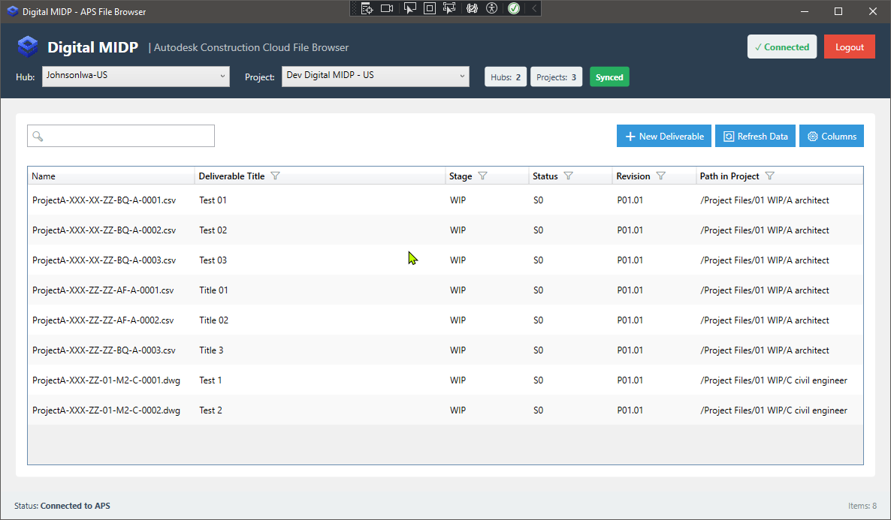

# 
  <strong style="font-size: 2em;">DigitalMIDP</strong> 

DigitalMIDP is a WPF desktop file register for Autodesk Forma projects. A designated Manifest Runner reads project inventory from Autodesk Platform Services (APS) and publishes a catalog in ACC. Reader clients display the Desktop Connector copy; sign-in, project discovery and attribute saves still use APS.

  

## Requirements
 - Windows 10 or later, x64 or ARM64.
 - .NET 8 SDK (to build) or the .NET 8 Desktop Runtime (to run).
 - Autodesk Forma account with project access.
 - Autodesk Desktop Connector installed and running.
    - The required project must be added to the Desktop Connector for local file access.

## Features

- OAuth 2.0 authentication with PKCE, and revoked at Autodesk on sign-out
- ACC hub, project, folder, and file browsing
- Custom metadata display and editing
- Deliverable creation from a template, with document numbers allocated against the project naming
  standard
- Local grid refresh and automatic updates when a new manifest revision syncs
- WPF MVVM architecture
- .NET 8 dependency injection
- Desktop Connector integration
- YouTube video demo: [LINK](https://www.youtube.com/watch?v=Z8LgGaSiit0)

## Quick Start

For deployment, install the default MSI client on readers and opt in to **Manifest Runner** on one operator machine. [Seed every project before rolling out its clients](./DigitalMIDP.ManifestRunner/README.md). Without a synced, locally readable manifest the grid cannot load a new catalog; it does not fall back to a live APS scan.

For a source build, see the [development guide](./docs/DEVELOPMENT.md).

## Documentation

- [Architecture](./ARCHITECTURE.md)
- [Reader guide](./docs/USER-GUIDE.md) · [Configuration](./docs/CONFIGURATION.md) · [MSI selection and smoke checklist](./DigitalMIDP.Installer/README.md)
- [Coding Standards](./docs/CODING-STANDARDS.md)
- [Development Guide](./docs/DEVELOPMENT.md)
- [Roadmap](./ROADMAP.md)
- [Troubleshooting](./docs/TROUBLESHOOTING.md)

## Disclaimer

DigitalMIDP is an independent open-source project. It is not affiliated with, endorsed by, sponsored by, or connected to Autodesk.

## License

[MIT LICENSE](./LICENSE)
