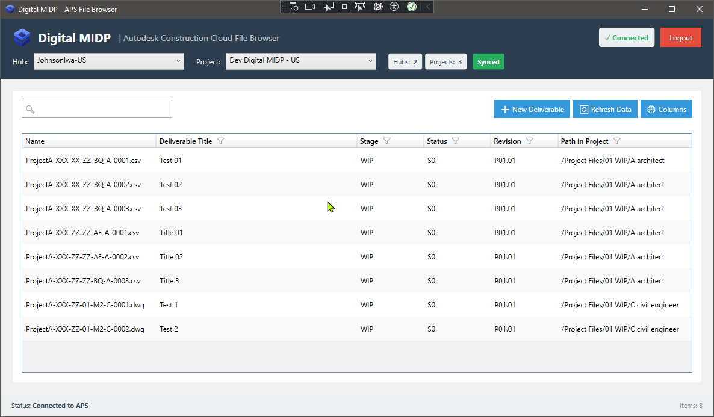

# 
  <strong style="font-size: 2em;">DigitalMIDP</strong> 

DigitalMIDP is a WPF desktop application that provides a digital files register, complete with custom attributes for Autodesk Forma based project. It uses Autodesk Platform Services (APS) APIs to display, list and allow direct local access to Autodesk Forma Files.

  

## Requirements
 - Windows 10 or later, x64 or ARM64.
 - .NET 8 SDK (to build) or the .NET 8 Desktop Runtime (to run).
 - Autodesk Forma account with project access.
 - Autodesk Desktop Connector installed and running.
    - The required project must be added to the Desktop Connector for local file access.

## Features

- OAuth 2.0 authentication with PKCE, and revoked at Autodesk on sign-out
- ACC hub, project, folder, and file browsing
- Custom metadata display and editing
- Deliverable creation from a template, with document numbers allocated against the project naming
  standard
- Automatic retry with backoff for transient APS failures, and short-lived caching of project
  configuration so a refresh does not re-request data that has not changed
- WPF MVVM architecture
- .NET 8 dependency injection
- Desktop Connector integration
- Youtbe video demo: [LINK](https://www.youtube.com/watch?v=Z8LgGaSiit0)

## Quick Start

See [Development.md](./docs/DEVELOPMENT.md)

## Documentation

- [Architecture](./ARCHITECTURE.md)
- [Coding Standards](./docs/CODING-STANDARDS.md)
- [Development Guide](./docs/DEVELOPMENT.md)
- [Roadmap](./ROADMAP.md)
- [Troubleshooting](./docs/TROUBLESHOOTING.md)

## Disclaimer

DigitalMIDP is an independent open-source project. It is not affiliated with, endorsed by, sponsored by, or connected to Autodesk.

## License

[MIT LICENSE](./LICENSE)
