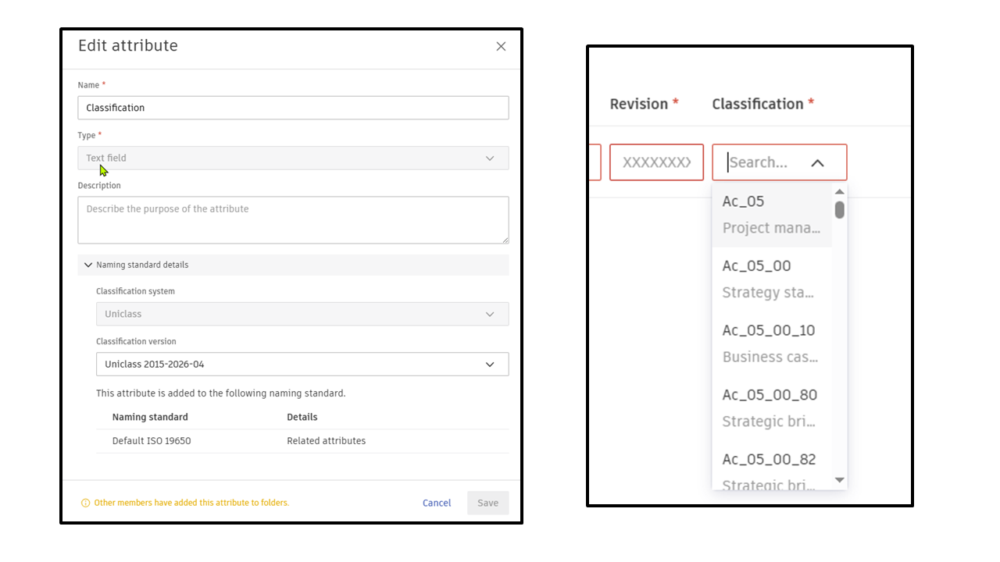

# Known Issues - DigitalMIDP

This document lists known limitations and operational workarounds.

---

## 1. Desktop Connector Synchronization Lag
- **Issue**: Files newly uploaded or updated via ACC web interface may not immediately reflect as "Synced" in Windows File Explorer or Desktop Connector.
- **Workaround**: Trigger a manual sync check in Desktop Connector tray or allow 30–60 seconds for background cloud sync to complete.

---

## 2. Rate Limiting on Large Hub Folders
- **Issue**: Browsing folders with over 1,000 files and dozens of custom metadata fields can trigger HTTP 429 responses from APS.
- **Mitigation**: The built-in `ApsResilienceHandler` manages retries automatically, and `ApsMetadataCache` caches schemas to minimize redundant calls.

---

## 3. Classification type mis-alignment
- **Issue**: When the custom document attribute includes a Classification type, the metadata and the corresponding APS API endpoints incorrectly list the attribute type as a "text field" instead of an "Array". Thus files created with Classification attributes are held in Forma's holding area.
- **Workaround**: Ensure project holding area is enabled, and populate with exact dropdown values from the Classification attribute, when creating deliverables. You can also set the classification attribute as optional. This ensures the files are correctly processed and not held in the holding area. 

  

